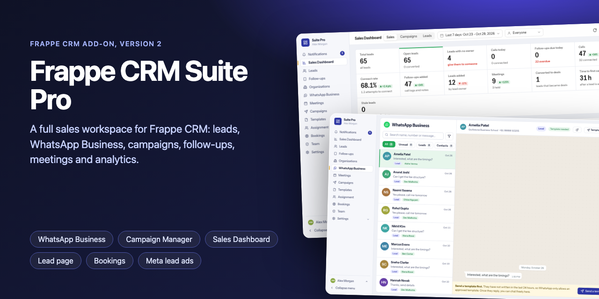
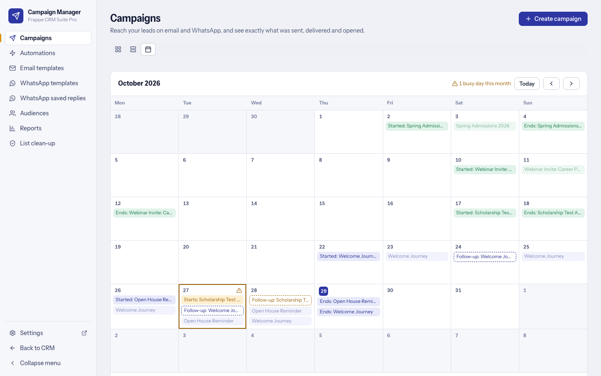
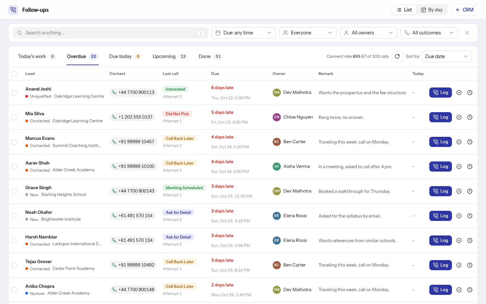
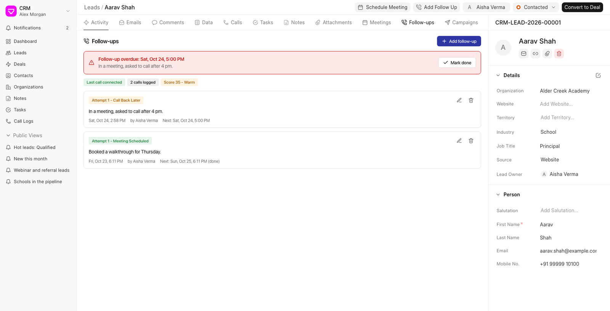
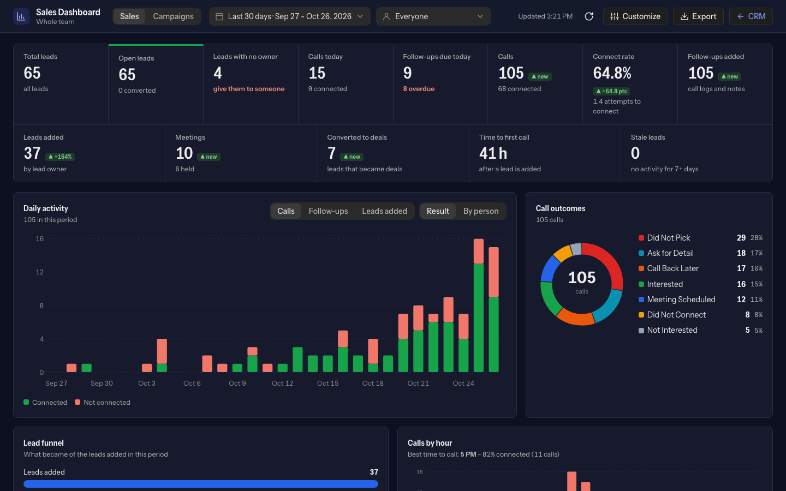
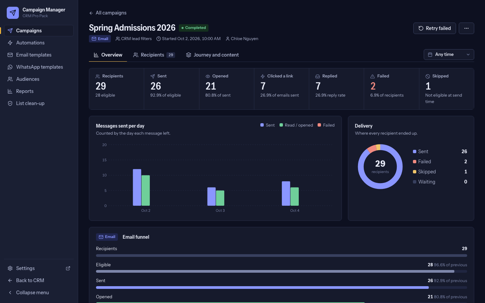
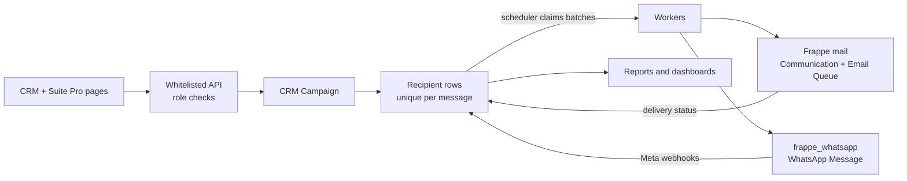

<div align="center">



# Frappe CRM Suite Pro

**Turn Frappe CRM into a complete sales and marketing engine: email and WhatsApp campaigns, follow-ups, meetings, lead assignment and analytics in one app.**

A free, open-source Frappe app. Install it like any other. Never fork or patch Frappe CRM.

[](LICENSE)
[](https://frappeframework.com)
[](https://github.com/frappe/crm)
[](pyproject.toml)
[](CHANGELOG.md)
[](CONTRIBUTING.md)

[Features](#features) &middot; [Screenshots](#screenshots) &middot; [Install](#quick-start) &middot; [Docs](docs/README.md) &middot; [Changelog](CHANGELOG.md)

</div>

---

<p align="center">
  
</p>

> The screenshots in this repository show a showcase site with **made-up sample data** (a fictional company, `example.com` addresses, fake phone numbers). The numbers are not benchmarks.

## Why Frappe CRM Suite Pro

- **No fork, no patch.** It is a normal Frappe app that adds to CRM's screens from the outside. You keep upgrading Frappe CRM the usual way.
- **Built on what you already run.** Campaign email goes through Frappe's own mail system and lands on the Lead's timeline. WhatsApp goes through the [`frappe_whatsapp`](https://github.com/shridarpatil/frappe_whatsapp) app and its Meta-approved templates. No second sender, no second template system.
- **Duplicate-proof sending.** A database-unique key per campaign, step, channel and lead, guarded launches and no blind retries mean nobody gets the same message twice, even after a double click or a worker restart.
- **Honest analytics.** It shows what Frappe and Meta really report, and says so when a number is not available, instead of guessing.
- **Role-aware everything.** A Sales User only ever sees their own data, enforced on the server. A Campaign Manager role keeps marketing separate from sales.
- **Installs in minutes.** `bench get-app`, `install-app`, `migrate`. A setup page with a live checklist tells you what is left.

## Features

### 1. Campaign Manager: email and WhatsApp

Build, send and measure campaigns without leaving CRM. One campaign can use both channels, one audience, one schedule and one report.

| | |
|---|---|
|  |  |
| **Audience builder** with live eligibility: how many leads can get email and WhatsApp, and why each of the others cannot. | **Preview as a real lead** on desktop and mobile, and a WhatsApp chat bubble. Send a test first. |
|  |  |
| **Visual email builder**, plus an HTML editor and a rich-text editor. Switch between them keeping your content. | **WhatsApp templates** with Meta status, a phone preview, a template creator and sync from Meta. |


- **Audience:** CRM filters, saved Leads-list segments or hand-picked leads, with per-channel eligibility and the reason for every exclusion.
- **Content:** three email editors (visual blocks, HTML, rich text), eight ready-made templates, templates shared both ways with CRM's own *Email Template* list, attachments up to 30 MB.
- **WhatsApp:** your approved templates, a template creator that submits through `frappe_whatsapp`, status sync from Meta, and each `{{1}}` variable tied to a lead field.
- **Personalization:** any Lead field plus `{{ owner_name }}`, `{{ sender_name }}`, `{{ today }}`, `{{ lead_url }}`; preview as a real lead.
- **Journeys:** steps on later days across both channels, each optionally conditional on the previous one (for example a WhatsApp reminder two days after an email nobody opened), with stop-on-reply.
- **Automations:** *when* a lead is created, changes status, replies, clicks, opens, bounces or opts out, *only for leads that match*, *then* send messages, set a status, create a follow-up or add a note. Each lead goes through once.
- **Tracking:** WhatsApp sent / delivered / read, email sent / opened / failed / bounced, signed click tracking, replies.
- **Control:** background batches with a rate limit, pause / resume / cancel, retry of messages that never reached the provider, sending hours in the campaign's time zone, health alerts when a running campaign fails too often.
- **Clean lists and consent:** opt-out list, signed unsubscribe link, WhatsApp STOP replies, WhatsApp opt-in rule, automatic removal of bounced emails and numbers not on WhatsApp.
- **Planning and results:** a calendar of what goes out when, cost and ROI from your own message prices, reports with date ranges and period comparison.

<details>
<summary>More screenshots: reports, calendar, automations, clean-up</summary>

| | |
|---|---|
|  |  |
|  |  |
|  |  |

</details>

Guide: [docs/campaigns.md](docs/campaigns.md) &middot; Reference: [docs/CAMPAIGN_MANAGER.md](docs/CAMPAIGN_MANAGER.md)

### 2. Sales Dashboard and Campaigns dashboard

| | |
|---|---|
|  |  |

- Date-range picker with presets and comparison to the previous period; KPI cards for calls, connect rate, follow-ups, leads, meetings and time to first call.
- Funnel, calls by hour (with the best time to call), attempts to connect, pipeline, leads by source and temperature, team performance for managers.
- Lead counts by any field, named counts (such as "Schools") and *Leads assigned by person*.
- A **Campaigns** tab with company-wide campaign results; dashboards can be customized by managers and exported to Excel or CSV.
- Light and dark, following CRM's theme. Sales Users only see their own numbers.

Guide: [docs/sales-dashboard.md](docs/sales-dashboard.md)

### 3. Follow-ups and call logging



- One form for every call: outcome, lead status, remark and next follow-up. Attempts are counted ("call attempt 3").
- Reminders when a follow-up is due, and **automatic escalation** after N unreached calls in a row.
- A work queue with Overdue, Due today, Upcoming and Done, filters, by-day view and bulk actions. Managers see everyone; Sales Users see their own.

Guide: [docs/follow-ups.md](docs/follow-ups.md)

### 4. Lead assignment


- **Rules** on any Lead field give new leads to people: round robin, least workload, or everyone together.
- **Assign leads now**, **Move leads** from one person to others, and a **History** with Undo for 24 hours. CRM notifies the new owners.

Guide: [docs/lead-assignment.md](docs/lead-assignment.md)

### 5. Meetings with Google Meet

| | |
|---|---|
|  |  |

- Schedule from a lead; Meet link and Google invitation created on one company calendar, so **sales users never sign in to Google**.
- Agenda, month, week and day views, guest choice, optional notifications, reminders, outcomes (Held, No Show, Rescheduled).
- A Manual Link provider for Zoom, Teams or any URL.

Guide: [docs/meetings-google.md](docs/meetings-google.md)

### 6. Lead scoring and stale alerts

- A 0 to 100 **Lead Score** (Hot, Warm, Cold) from connected calls, the latest outcome, meetings and recency, shown as a column on the Leads list and Kanban cards.
- **Stale-lead alerts** to the owner after N quiet days (default 7). Columns for Next Follow-up, Last Call Outcome, Call Attempt and Next Meeting.

### 7. Bookings: public booking pages

- A **widget** is a public page (`/book/<name>`) where a visitor picks a date and time and leaves their details. It can be linked or embedded on any website, with its own branding, hours, hosts, form fields and messages.
- Each booking creates a **Lead** (matched by email, then phone), a **CRM Meeting** with a Google Meet link, and keeps the visitor's first-touch **UTM** source, medium and campaign for the Report.
- **Messages** go out by email and WhatsApp from the same template library: confirmation, reschedule, cancel and reminders (24 hours, 1 hour, 30 minutes and at the start). The visitor can reschedule or cancel from a link. **Notify** sends them again by hand, and can tell the hosts too.
- **No double booking**, even with two visitors at the same moment; spam checks without a CAPTCHA (phone and email checks, one open booking per contact, rate limits, a hidden field).
- Bookings are shown as a table or cards, inside Meetings as **Website booking** (in their own colour), and in a **Report** of bookings by campaign, source, page and day.

Guide: [docs/DEMO_BOOKING.md](docs/DEMO_BOOKING.md)

### 8. Team and access

- A System Manager opens **Team and access** to add people (picture, name, number, designation, company, role, preset, team leader) and to switch accounts on or off.
- Each person gets a **preset** (Sales Executive, Team Lead, Sales Manager, Campaign Executive, Template Designer, Booking Host) and can have changes on top of it. Levels are *No access / Own only / My team / Everyone*, where **My team** follows CRM's Sales Hierarchy. They apply to follow-ups, meetings, bookings, the dashboard, lead assignment and every part of the Campaign Manager.
- Nothing changes for people nobody has set up: the old role defaults still apply.

Guide: [docs/roles-and-permissions.md](docs/roles-and-permissions.md)

### 9. Setup page, branding, roles and permissions

| | |
|---|---|
|  |  |

- **Settings** in the CRM menu (System Managers only) opens the setup page, including **Branding**: the name, logo, favicon, login page and footer, written to CRM's brand settings, Website Settings and the Desk together, with a preview and a reset.
- A **setup page** with a live checklist (Google, outgoing email, scheduler, worker, WhatsApp, country code), grouped settings with explanations, left-menu order and visibility, default list / Kanban views for everybody, and dashboard counts.
- **Roles:** Sales User sees only their own leads, calls, notes, tasks, follow-ups and meetings (server-enforced, including direct links and exports). The **Campaign Manager** role builds and runs campaigns; Sales Users can only look. Only System Managers assign leads.
- **Pages inside the CRM:** Sales Dashboard, Follow-ups, Meetings, Campaigns and Assignment open beside CRM's own menu with their own addresses, so Back, reload and shared links work.

Guide: [docs/roles-and-permissions.md](docs/roles-and-permissions.md) &middot; [docs/settings-reference.md](docs/settings-reference.md)

## Screenshots

<details>
<summary>Dark theme</summary>

| | |
|---|---|
|  |  |

</details>

<details>
<summary>Inside the CRM</summary>

| | |
|---|---|
|  |

</details>

All screenshots can be regenerated with [docs/screenshots](docs/screenshots/README.md).

## Feature comparison

Frappe CRM 1.x core (as far as we know it) versus CRM with Frappe CRM Suite Pro installed.

| Capability | Frappe CRM 1.x core | With Frappe CRM Suite Pro |
|---|---|---|
| Leads, deals, contacts, organizations, notes, tasks, call logs, email | Yes | Unchanged |
| Email and WhatsApp bulk campaigns | Not included | Campaign Manager |
| Multi-step journeys and event-driven automations | Not included | Yes |
| Visual email builder and template library | Basic email templates | Visual, HTML and rich-text editors, shared with CRM's Email Template list |
| Opt-out list, unsubscribe link, WhatsApp consent rule | Not included | Yes |
| Campaign reports with date ranges, funnel, cost and ROI | Not included | Yes |
| Call follow-ups with attempts, outcomes and escalation | Call logs | Follow-up form, queue, reminders, escalation |
| Sales Dashboard with team performance and Excel export | CRM dashboard | Role-aware dashboard, customizable, exports |
| Automatic lead assignment with undo | Not included | Rules, assign now, move, history |
| Google Meet / Calendar meetings from a lead | Not included | Yes, one company account |
| Lead score and stale-lead alerts | Not included | Yes |
| Sales Users see only their own data | CRM's own lead rule | Extended to calls, notes, tasks, follow-ups and meetings |

## How it works

1. **Install** adds its doctypes, a few custom fields and a Frappe CRM Suite Pro workspace; every `migrate` re-checks them (it never overwrites what an admin changed).
2. **A script is added to CRM's page** through a Frappe `after_request` hook; it draws the tabs, buttons, menu rows and pages inside CRM.
3. **Pages** are plain Vue 3 (no build step) calling whitelisted Python APIs that check the role on every call.
4. **Campaigns** are materialised into one recipient row per message; the scheduler claims rate-limited batches and workers send them through Frappe mail or `frappe_whatsapp`.
5. **Status flows back** from Frappe's email records and Meta's webhooks into the recipient rows, and from there into reports.



## Quick start

```bash
cd ~/frappe-bench
# Frappe CRM 1.x, if it is not on the site yet
bench get-app crm --branch main
bench --site your-site.com install-app crm

# Frappe CRM Suite Pro
bench get-app https://github.com/sidrajputt/frappe-crm-pro-pack --branch main
bench --site your-site.com install-app crm_addons
bench --site your-site.com migrate
bench build --app crm_addons        # only if assets were not linked
bench restart
```

Then hard-refresh the CRM (Ctrl/Cmd + Shift + R) and open **`/pro-pack-setup`** as a System Manager for the checklist. For WhatsApp campaigns also install `frappe_whatsapp`. Update with `bench update --apps crm_addons`, then `migrate` and `restart`. Uninstall with `bench --site your-site.com uninstall-app crm_addons`.

Full walkthrough: [docs/getting-started.md](docs/getting-started.md).

### Requirements

| Component | Supported | Notes |
|---|---|---|
| Frappe Framework | **v15** (developed and tested) | The Frappe APIs used also exist on v16 and the v17 development branch, so newer versions are allowed but not yet tested |
| Frappe CRM | **1.x** (`main` branch) | CRM 2.0 needs Frappe 16+ and is best-effort |
| Python | 3.10 - 3.12 | |
| Database | MariaDB | PostgreSQL is not supported |
| Email campaigns | an outgoing Email Account marked *Default Outgoing* | |
| WhatsApp campaigns | `frappe_whatsapp`, an Active account, approved templates | Optional |
| Background jobs | scheduler and a worker | `bench enable-scheduler` |
| Browser | Current Chrome, Edge, Firefox, Safari | |

Works on Leads: Deals are not extended.

The shortcuts in CRM's left menu are added by copying CRM's own menu rows, so they follow the CRM's own look on both link-style and button-style menus.

## Documentation

| | |
|---|---|
| [Getting started](docs/getting-started.md) | Install, setup, roles, 15-minute tour |
| [Campaigns](docs/campaigns.md) | First email and WhatsApp campaign, journeys, automations, reports, variables, consent |
| [Sales Dashboard](docs/sales-dashboard.md) &middot; [Follow-ups](docs/follow-ups.md) &middot; [Assignment](docs/lead-assignment.md) &middot; [Meetings](docs/meetings-google.md) | Feature guides |
| [Roles and permissions](docs/roles-and-permissions.md) &middot; [Settings reference](docs/settings-reference.md) | Reference |
| [FAQ](docs/faq.md) &middot; [Troubleshooting](docs/troubleshooting.md) | Help |
| [Campaign Manager reference](docs/CAMPAIGN_MANAGER.md) &middot; [Admin guide](docs/ADMIN_GUIDE.md) | Deep dives |

Everything is indexed in [docs/README.md](docs/README.md).

## Roadmap

- **Automatic Zoom and Microsoft Teams meetings** (planned); other apps can already add meeting providers through a hook, see [docs/ADDING_A_PROVIDER.md](docs/ADDING_A_PROVIDER.md).
- **Not supported today:** Deals as campaign recipients (Leads only) and PostgreSQL.

Ideas and votes are welcome in the issues.

## Community, contributing, security

- Questions and bugs: [GitHub Issues](https://github.com/sidrajputt/frappe-crm-pro-pack/issues).
- Contributing: [CONTRIBUTING.md](CONTRIBUTING.md) (bench setup, tests, code style, pull request flow).
- Security: please report privately, see [SECURITY.md](SECURITY.md).
- Release notes: [CHANGELOG.md](CHANGELOG.md).

<details>
<summary>Development and project layout</summary>

```bash
bench --site your-site.com set-config allow_tests true
bench --site your-site.com run-tests --app crm_addons
bench --site your-site.com set-config allow_tests false
```

```
crm_addons/
  hooks.py            hooks: permissions, scheduler, after_request, chart hook, redirects
  install.py          everything set up on install / migrate, and removed on uninstall
  api.py              meetings API used by the UI
  followups.py        follow-up API, attempts, escalation, reminders
  reports.py          Sales Dashboard data and the Excel / CSV export
  dashboard.py        CRM dashboard charts and the Campaigns tab
  scoring.py          lead score rules
  stale.py            stale-lead alerts
  permissions.py      who sees what (a Sales User only ever sees their own data)
  assignment.py       lead assignment rules, assign now, move leads, undo
  views.py            default list / Kanban views for everybody
  setup_page.py       the setup page and its checklist
  campaigns/          Campaign Manager: engine, automation, tracking, hygiene, health, ROI, templates
  providers/          Google Meet, Manual Link, Zoom / Teams placeholders
  public/             the UI: plain Vue 3 and JavaScript, no build step
docs/                 guides and reference
```

</details>

## License and trademarks

[MIT](LICENSE). Frappe CRM Suite Pro is an independent open-source project. It is not affiliated with, endorsed by or sponsored by Frappe Technologies Pvt. Ltd., Meta Platforms, Inc. or Google LLC. Frappe, ERPNext and Frappe CRM are trademarks of Frappe Technologies Pvt. Ltd.; WhatsApp and Meta are trademarks of Meta Platforms, Inc.; Google, Google Meet and Google Calendar are trademarks of Google LLC. All other names belong to their owners.

---

<sub>Topics: Frappe CRM add-on, booking pages for Frappe CRM, Frappe CRM campaigns, WhatsApp and email marketing for Frappe CRM, Google Meet for Frappe CRM, follow-up and call log, lead assignment, lead scoring, sales dashboard, Frappe v15 app.</sub>
