# Campaigns

The Campaign Manager sends email and WhatsApp campaigns to your CRM leads. Open it from the **Campaigns** entry in CRM's left menu, the **Campaigns** button on the Leads list, or go to `/campaigns`.

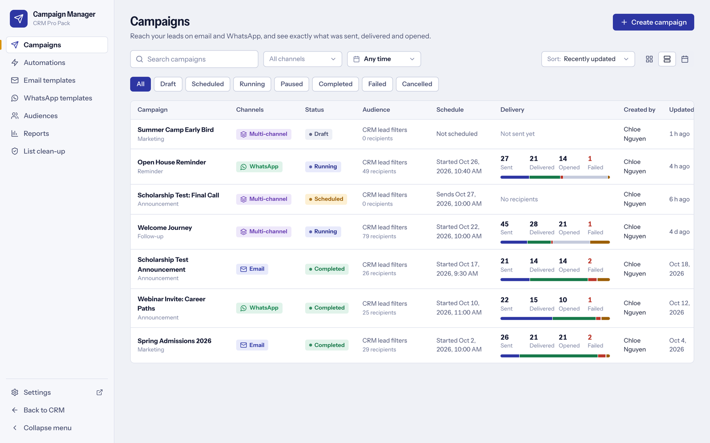

Email goes through Frappe's own mail system and is logged on the Lead's timeline. WhatsApp goes through the `frappe_whatsapp` app and its Meta-approved templates. Nothing here talks to Meta or a mail provider directly, and there is no second template system. The technical reference is [CAMPAIGN_MANAGER.md](CAMPAIGN_MANAGER.md).

**Before you start:** an outgoing Email Account marked *Default Outgoing* (email), `frappe_whatsapp` with an Active account and approved templates (WhatsApp), the scheduler and a worker on the `long` queue. The [setup page](getting-started.md#3-first-time-setup-the-setup-page) checks all of it. You need the **Campaign Manager** role (or Sales Manager / System Manager) to create anything; a Sales User can only look.

Contents: [first email campaign](#your-first-email-campaign) - [first WhatsApp campaign](#your-first-whatsapp-campaign) - [journey](#build-a-journey) - [automation](#set-up-an-automation) - [read the report](#read-the-report) - [email templates](#email-templates) - [template variables](#template-variable-reference) - [opt-outs and consent](#opt-outs-and-consent) - [limits and best practices](#limits-and-best-practices)

## Your first email campaign

Press **Create campaign**. The wizard has five steps, shows a live summary (audience size, eligibility, channels, schedule, warnings) on the side, and saves your draft on every step and every 30 seconds.

1. **Details.** Name, type (Marketing, Follow-up, Announcement, Reminder, Other) and owner.
2. **Audience.** Choose one of three cards: *Filter CRM leads* (rows of field, operator, value; you can save the filter as a segment), *Saved segment* (the saved filters of the Leads list, with live counts) or *Pick leads manually*. The page always shows how many leads match, how many can receive Email and WhatsApp, **why the others cannot** (no or invalid address, opted out, not opted in, duplicate) and a sample table with the reason per lead.

   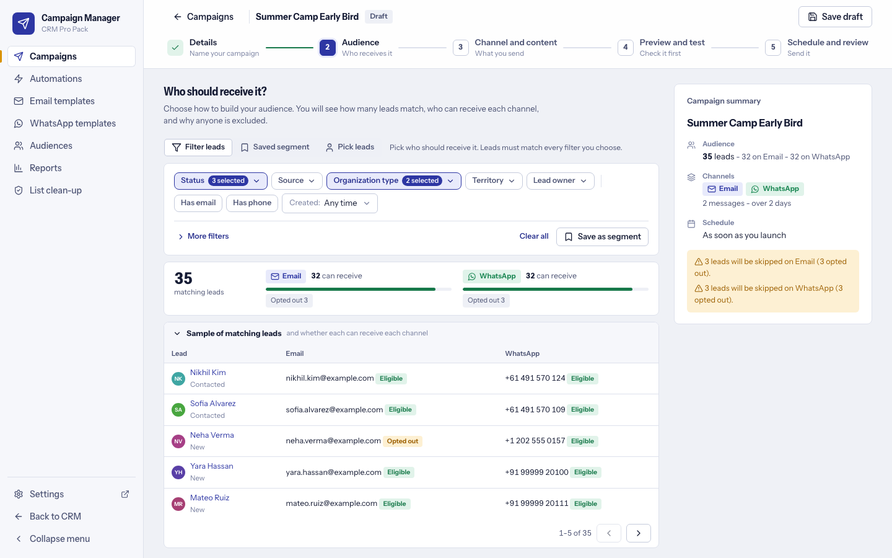

3. **Channel and content.** Tick Email, pick or create a template (see [email templates](#email-templates)), write the subject. *Insert variable* works in the subject and every text field.

   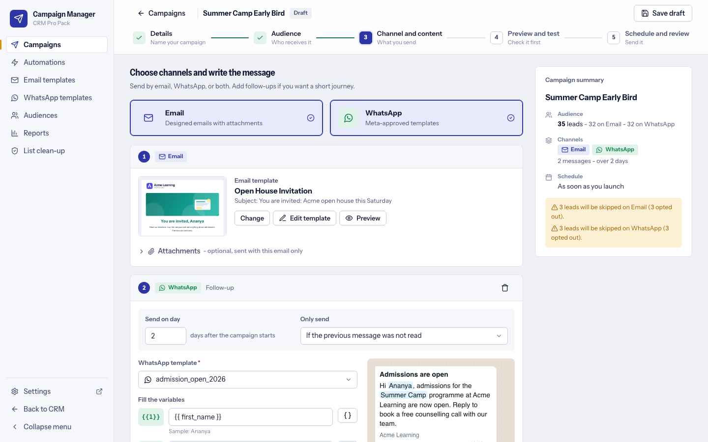

4. **Preview and test.** Preview as a real lead on Desktop or Mobile in an email-client frame, and **Send test email** to up to 10 addresses (test mails carry a `[Test]` prefix and no unsubscribe link, and create no campaign data).

   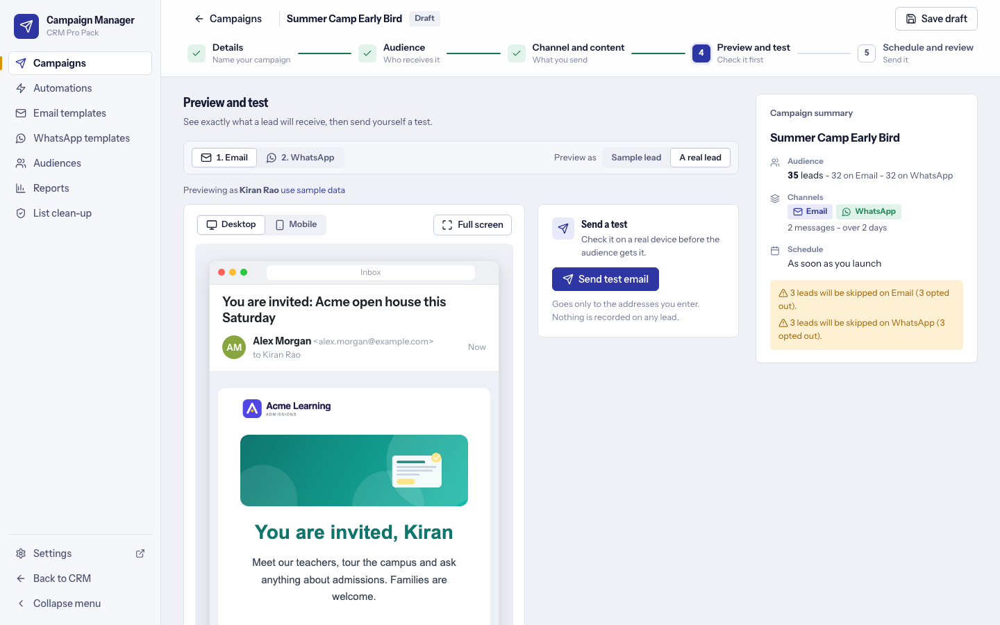

5. **Schedule and review.** Send now or on a date, time and time zone. *Advanced options* hold sending hours, click tracking, journey steps and delivery overrides. Launch asks a second time and states the exact number of messages.

   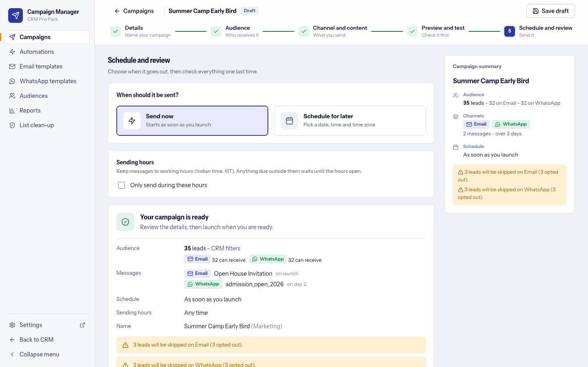

Start with three leads you own. After launching, the campaign page refreshes by itself: rows go Queued, Sent. The email appears on the Lead's timeline. The unsubscribe link in the mail adds the address to the opt-out list.

## Your first WhatsApp campaign

1. In **WhatsApp templates** check that your template is *Approved*. Templates are read from `frappe_whatsapp`. Managers can press **Create template** (see below) and **Sync status from Meta**.
2. In the wizard tick WhatsApp in *Channel and content*, pick an approved template and map each `{{1}}`, `{{2}}` variable to a lead field (or let the mapping saved with the template fill it in). A lead with an empty mapped field is skipped, with that reason.
3. Check the phone preview, optionally **Send test message** (billed by Meta like any message, 10 per user per hour), and mind consent: with the default *Require opt-in* a lead needs the **WhatsApp Opt-in** box ticked, or you confirm consent on the campaign.
4. Launch. Delivered and Read come back from Meta's webhook through `frappe_whatsapp`.

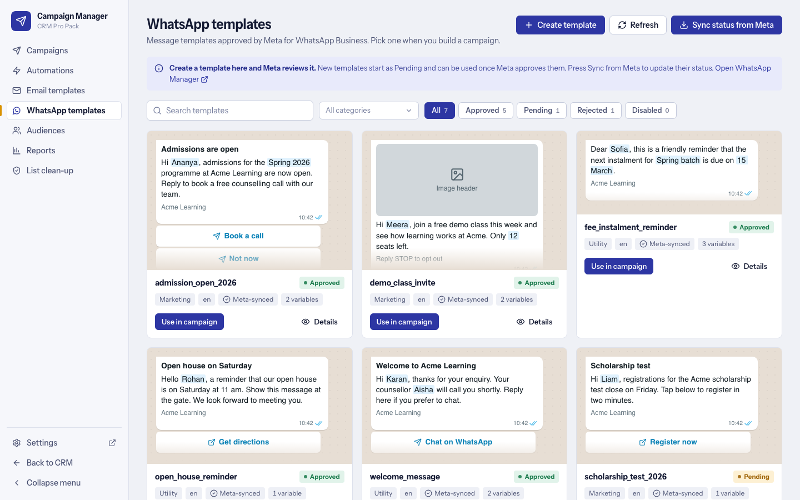

**Create template** (managers) saves `frappe_whatsapp`'s own *WhatsApp Templates* document, whose own code submits it to Meta, so it starts as Pending. Name, category, language, header (text, image or document), body with numbered variables and examples, footer and buttons, with a live preview. The name is checked live against Meta's rules (lower case, numbers, underscores; new for that language). Editing or deleting a template afterwards is done in `frappe_whatsapp` / Meta.

## Build a journey

A campaign is a list of steps. In the wizard open *Advanced options* and add steps. Each step has:

- **Send on day**: days after the campaign starts (0 is right away).
- **Channel and template**: Email or WhatsApp, so a journey can mix them.
- **Send only if** (steps after the first), checked on the previous step for the same lead when the step is due: was sent, was read or opened, was **not** read or opened, or failed or was skipped. For a fallback ("if the WhatsApp failed, send an email") use *failed or skipped*.
- **Stop the journey for a lead who replies** (campaign switch): later steps are skipped for a lead who writes back by WhatsApp or email.

Example: Day 0 email, Day 2 WhatsApp only if the email was not opened, Day 5 email. Editing a journey after launch is refused; pause a single step from the campaign page if needed. Conditions on email *clicks* are not supported.

## Set up an automation

Automations are in the Campaign Manager's side panel. Each one reads as a sentence: **When** something happens, **only for leads that match** (optional filters or a saved segment), **then** do an ordered list of actions.

- **When:** a lead is created, a lead's status changes, a lead replied, clicked a link, opened or read a message, a message failed or bounced, a lead opted out (optionally only for one campaign's messages).
- **Then:** send messages, set the lead status, create a follow-up, add a note to the lead.
- Each lead goes through an automation **once**. You can have many automations, each with an On switch. Start from an idea such as "welcome new leads".
- "Send messages" runs in a managed campaign, so sending hours, tracking, retries and reports work as everywhere else.

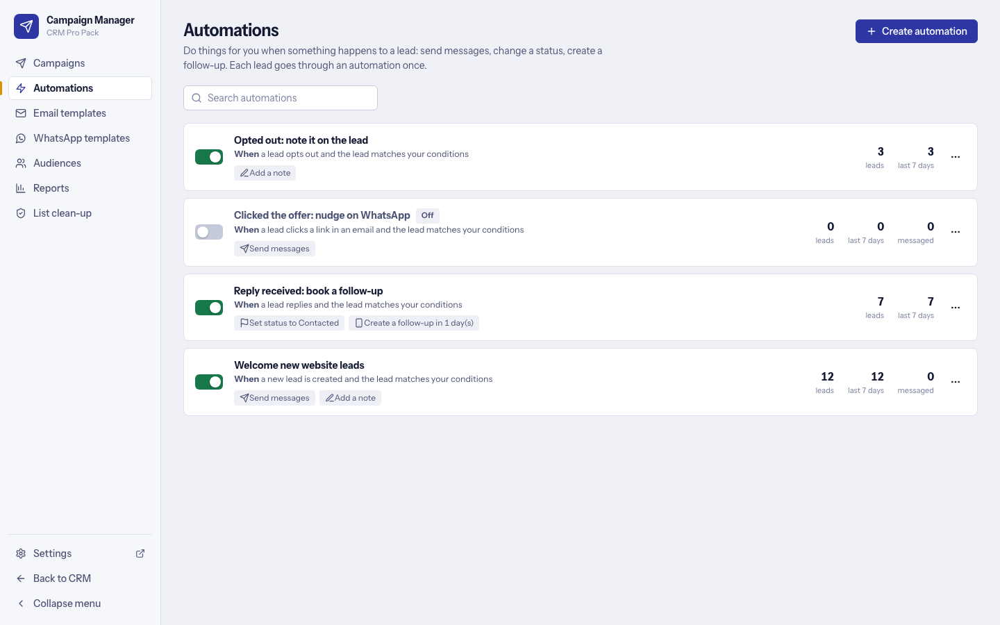

## Read the report

Open a campaign for its page: KPI cards, messages per day, a delivery donut, a funnel per channel, failure and skip reasons, the Journey table, and a searchable **Recipients** report with CSV export. Running campaigns refresh themselves. A **Reports** page compares all campaigns in a date range (with *Compare to previous period*) and the **calendar** shows what goes out when; amber days have more than one campaign sending.

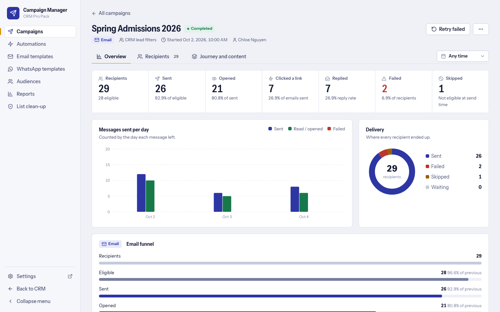
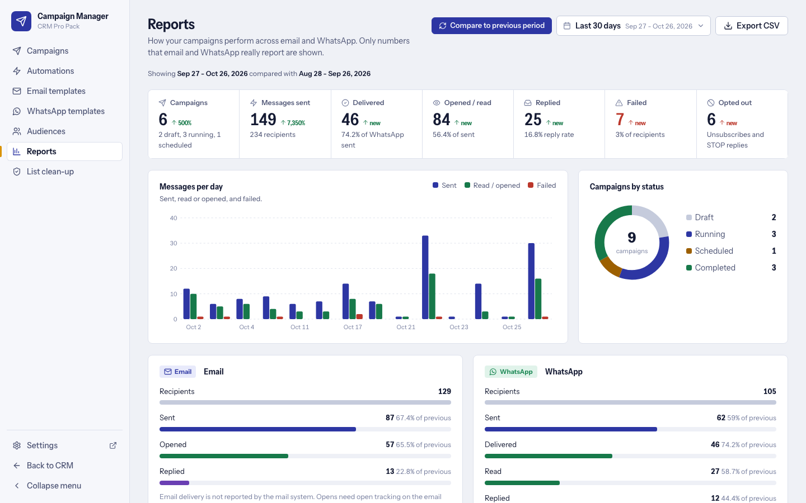

What is counted is honest: WhatsApp reports Sent, Delivered, Read and Failed. Email reports Queued, Sent and Failed always; **Opened** only when the outgoing Email Account has *Track Email Status* on, or through click tracking (a click counts as an open); Bounced when your mail provider reports it. Frappe does not report email *delivered*, so that number is not shown. **Replied** means the lead wrote back within 14 days of a send. Cost and ROI need your prices in the [settings](settings-reference.md#campaign-manager).

## Email templates

One shared library for campaigns and follow-ups. A template is built in one of three editors, and you can switch between them (with a warning when formatting would be lost):

- **Visual builder:** blocks for heading, text, image, button, divider, spacer, a Row with 1 to 6 columns, banner, social links, footer and custom HTML. Output is table-based, inline-styled HTML. Text blocks have bold, italic, underline, font, size, colour, alignment, links and lists.
- **HTML editor:** line numbers, syntax colours, Format, Validate, an Image button, live preview.
- **Rich text:** toolbar, links, lists, headings and images.

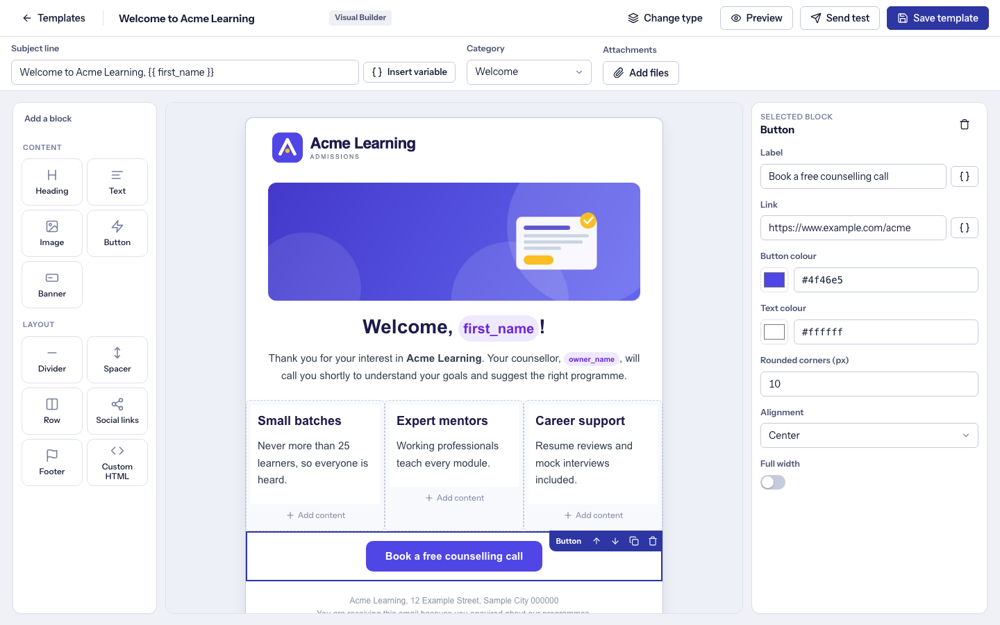
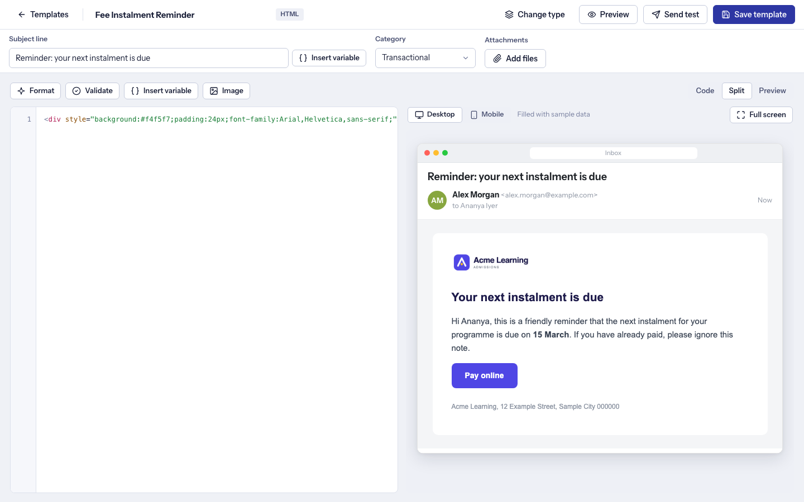

Eight ready-made templates (welcome, follow-up after a call, missed call, admissions promotion, event invitation, newsletter, announcement, session reminder) are added to the library once; you own them afterwards. A template saved here also appears in CRM's own **Email Template** list (the one used when mailing a lead by hand), and a template made there for Leads comes back into the library. Attachments up to **30 MB** per email are allowed (never above Frappe's *Max File Size*). A template that is used by a campaign can be archived but not deleted.

## Template variable reference

Use `{{ name }}` in subjects, email bodies and WhatsApp variable mappings. Unknown variables are rejected when an email template is saved.

| Variable | Meaning |
|---|---|
| `{{ first_name }}`, `{{ lead_name }}`, `{{ email }}`, `{{ mobile_no }}`, `{{ organization }}` | The usual Lead fields |
| Any other Lead field (including your custom fields) | The editor lists the real fields of your site; use the field name |
| `{{ owner_name }}` | The lead owner's full name |
| `{{ sender_name }}` | The campaign owner's full name |
| `{{ today }}` | Today's date |
| `{{ lead_url }}` | Link to the lead in CRM |

Rendering is sandboxed and values are HTML-escaped in email. Previews use sample data or a real lead you choose.

## Opt-outs and consent

- **One opt-out list** (*CRM Campaign Opt Out*, unique per channel and value) is checked before every send and **always wins**.
- **Email:** every campaign email carries a signed unsubscribe link (a tampered link is refused). It adds the address to the list and to Frappe's global *Email Unsubscribe*.
- **WhatsApp:** a reply of STOP, UNSUBSCRIBE, CANCEL, OPTOUT, OPT OUT, UNSUB or STOP ALL opts the number out. Managers can also opt a recipient out from the report, or add entries by hand.
- **WhatsApp consent** (setting *WhatsApp consent*): *Require opt-in* (default) sends only to leads whose **WhatsApp Opt-in** box is ticked, unless the campaign owner confirms consent on the campaign (recorded in its version history); *Allow unless opted out* sends to every lead with a valid number.
- **List clean-up** (left menu, managers): hard-bounced emails and numbers that are not on WhatsApp are taken off the sending list automatically; **Put back** restores one; **Scan past failures** applies the rule to earlier failures.

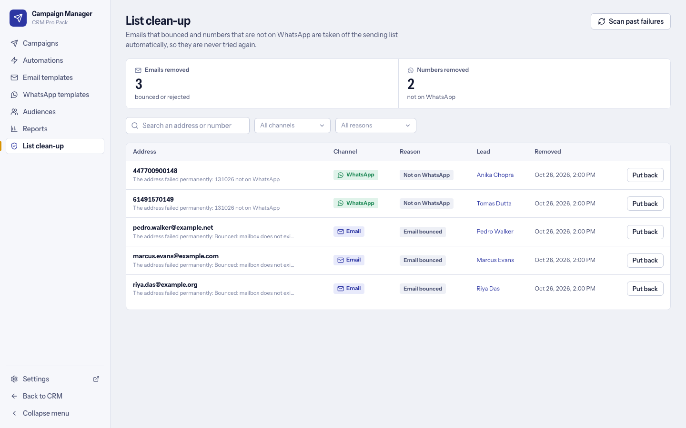

You remain responsible for having a lawful basis to message people. The app gives you the mechanics (opt-in field, opt-out list, unsubscribe link), not legal advice.

## Limits and best practices

**Defaults** (all in the [settings](settings-reference.md#campaign-manager); a campaign can override batch size, rate and retries under *Delivery Settings*): 100 messages per batch, 300 messages per minute per campaign, 2 automatic retries with back-off from 5 minutes, 30 MB attachments.

**How duplicates are prevented:** a database-unique key per campaign, step, channel and lead; a guarded Launch; and a message left half-sent after a crash is never re-sent (it is recovered from the provider's record or marked Failed). Retries only happen for errors that prove the provider did not accept the message.

**Not supported:** conditions on email clicks; email *delivered* and *clicked* metrics from Frappe (clicks are tracked by Pro Pack's own signed links); editing or deleting a WhatsApp template (do that in `frappe_whatsapp` / Meta); Deals as recipients (Leads only); a rate limit across campaigns (it is per campaign).

**Good habits**
- Launch to a handful of your own leads first, then the real audience.
- Keep the rate under your mail provider's and Meta's limits.
- Use **Sending hours** to keep messages to working hours in the campaign's time zone; anything due outside waits.
- Watch the health banner: every 5 minutes the owner is warned when the failure rate over the last hour passes 30% (after at least 20 messages), when a login is refused or no outgoing account exists.
- Prefer approved *utility* templates for reminders and keep marketing templates opt-in only.
- Never edit a journey after launch; duplicate the campaign instead.
