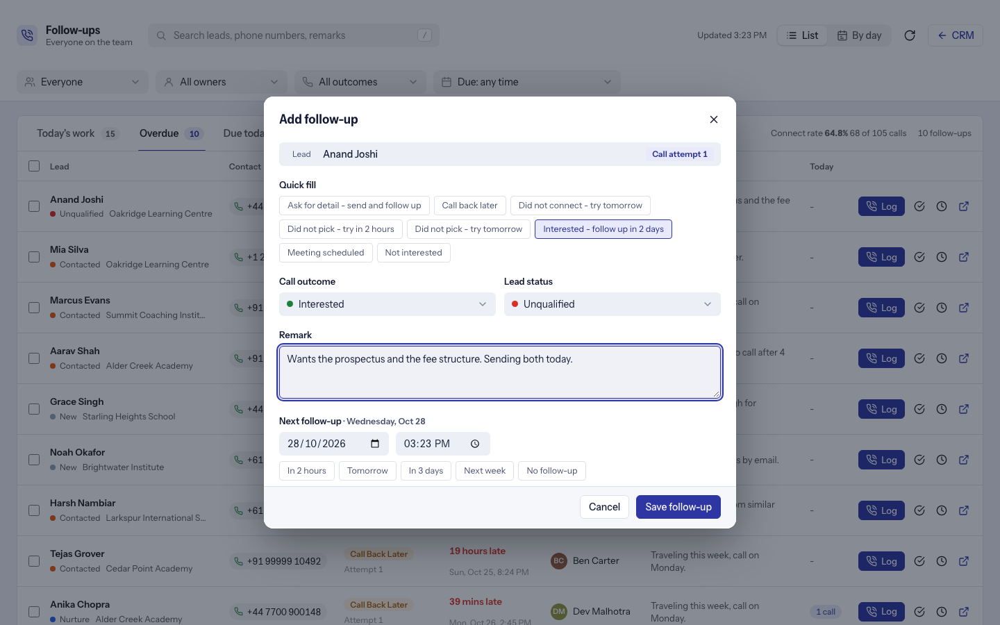

# Follow-ups and call logging

Every call attempt on a lead is logged in one short form, with its outcome and the next follow-up. The follow-up workspace turns that into a work queue.

## Log a call

Open a Lead and click **Add Follow Up** (or use the **Follow-ups** tab). The form has:

- **Quick-fill templates** (eight starters are added on install; edit them under **CRM Follow Up Template** in Desk, tick or clear *Enabled* to show or hide one).
- **Call outcome:** Did Not Pick, Did Not Connect, Interested, Not Interested, Meeting Scheduled, Ask for Detail, Call Back Later.
- **Lead status**, which you can change right there.
- A remark, and the **next follow-up** date and time with quick buttons.

How it behaves:

- **Attempt counting.** "Call attempt 1, 2, 3" counts calls in a row that did not reach the person (Did Not Pick or Did Not Connect), and starts again after a call that did.
- **The next follow-up is the outcome.** Logging a newer follow-up closes the older open one.
- **Reminders.** The follow-up owner is notified in the CRM (and by email when *Email reminders to CRM team members* is on) when a follow-up is due. The scheduler must be running.
- **Escalation.** After N unreached calls in a row (setting *Escalate after this many calls*, default **3**, `0` = off) a note is posted on the lead's timeline, and the lead owner and all Sales Managers are notified. Optionally the lead moves to a status you choose (for example Unreachable).
- **WhatsApp after a missed call** (optional): when the call is logged as Did Not Pick or Did Not Connect and WhatsApp is set up in CRM, the form offers a message (default text in the settings).
- Every follow-up is posted on the lead's timeline.

## The Follow-ups workspace

Open **Follow-ups** from CRM's left menu, the Leads list or Kanban view, or go to `/followups` for the full-screen page (**Open in a new tab** keeps your filters). Deep links: `/followups#today`, `#overdue`, `#upcoming`, `#done`.

| Tab | Shows |
|---|---|
| Today's work | (Sales Users) the calls and follow-ups you logged today, with a **Today** column |
| Overdue / Due today / Upcoming | Open follow-ups by due time |
| Done | Completed ones, or ones followed up by a newer call (the last 30 days unless you set a date range) |

- **Filters:** search (lead name, phone, email, organization or remark), owner, call outcome, due-date range. Show as a **List** or **By day**.
- **Row actions:** log a call, mark done, reschedule (quick picks or a date and time), open the lead. Select rows to **mark many done** or **reschedule them together**; each is checked against your permission.
- Phone numbers are click-to-call links.
- **Who sees what:** managers see everyone's follow-ups and can narrow to one person; a Sales User sees only their own, whatever the address asks for.

## Lead columns and score

The Leads list and Kanban cards can show Next Follow-up, Last Call Outcome, Last Follow-up Remark, Call Attempt, Next Meeting and **Lead Score** (use the list's *Columns* setting). The score is 0 to 100, labelled **Hot** (60 or more), **Warm** (30 to 59) or **Cold**. It is a rule of thumb from `scoring.py`: connected calls (up to three, +10 each), the latest outcome (Interested +20, Meeting Scheduled +15, Ask for Detail and Call Back Later +5, Not Interested -40), meetings held (up to two, +20 each) or coming up (+10), unreached calls in a row (-5 each, up to four), and recent (+10) or no (-10) activity. It refreshes when a follow-up or meeting changes and once a day; switch it off with *Score Leads from their activity*.

**Stale-lead alerts:** open leads with no comment, email, call, task, note, follow-up or meeting for N days (default **7**, `0` = off) notify their owner once per quiet spell (a daily job).
