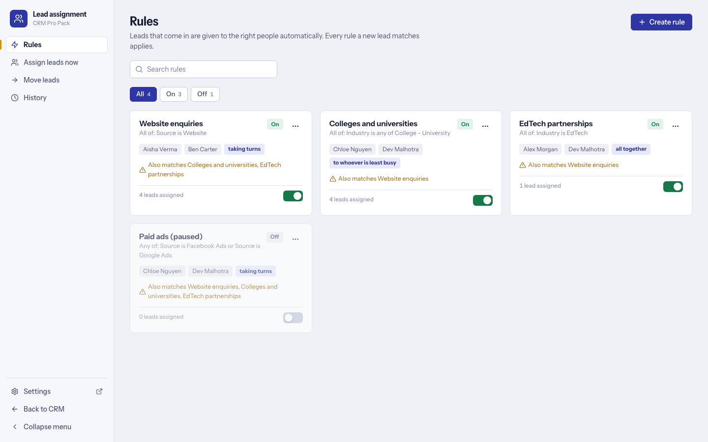

# Lead assignment

System Managers only. Open **Assignment** in CRM's left menu (or `/assignment`). It is its own page, not part of the Campaign Manager, and every server call behind it checks the role. The complete reference is [ASSIGNMENT.md](ASSIGNMENT.md); this page is the short, task-based version.

Four pages: **Rules**, **Assign leads now**, **Move leads**, **History**.

## Give new leads to people automatically

1. **Rules > Create rule.** Read it as a sentence: *a lead that looks like this goes to these people.*
2. **Conditions** on any Lead field (custom fields too), *all of these* or *any of these*.
3. **People and how they share:**
   - **Round robin**: one person per lead, taking turns.
   - **Least workload**: the person with the fewest open leads plus follow-ups still to do.
   - **All of them together**: everybody gets every lead; the first person is the owner and the others are assigned too. The choice appears when you pick two or more people.
4. Optionally also give the matching leads that have no owner to them now.
5. Save and switch it on. Each person is notified in CRM; no email is sent; disabled users are skipped.

Every enabled rule a new lead matches applies, in the order shown. Saving or enabling a rule that *can* match the same leads as another asks first and lists the overlap. A lead created by a data **import** is not assigned automatically; use *Assign leads now* afterwards.

## Assign leads you already have

On a rule use **Assign existing leads**, or open **Assign leads now** and type conditions without making a rule. You see a count and a sample first, and can choose only leads with no owner or all matching leads.

## Move leads from one person to others

**Move leads** takes everything one person owns or is assigned and gives it to one or more others (round robin, least workload or all together), for example when someone leaves. They lose access to those leads. Open leads only, or every lead.

## History and undo

Every assignment is logged in **History** (what, to whom, by whom). **Undo** puts leads back as they were, for **24 hours**; a lead somebody changed since is left alone and counted as skipped. Jobs over 300 leads run in the background, so a worker must be running.

Assignment uses CRM's own mechanism (the lead owner field, an assignment ToDo and a share), so CRM's lists, permissions and notifications behave as for a hand-made assignment.
