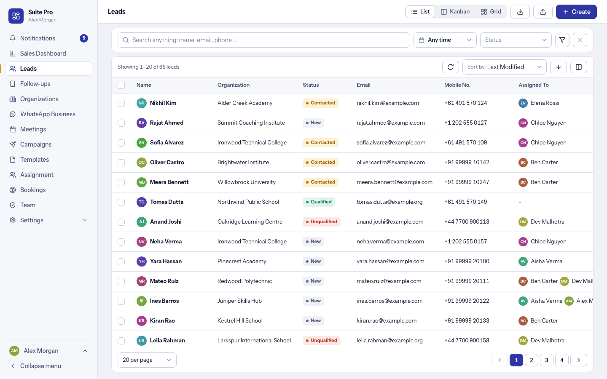
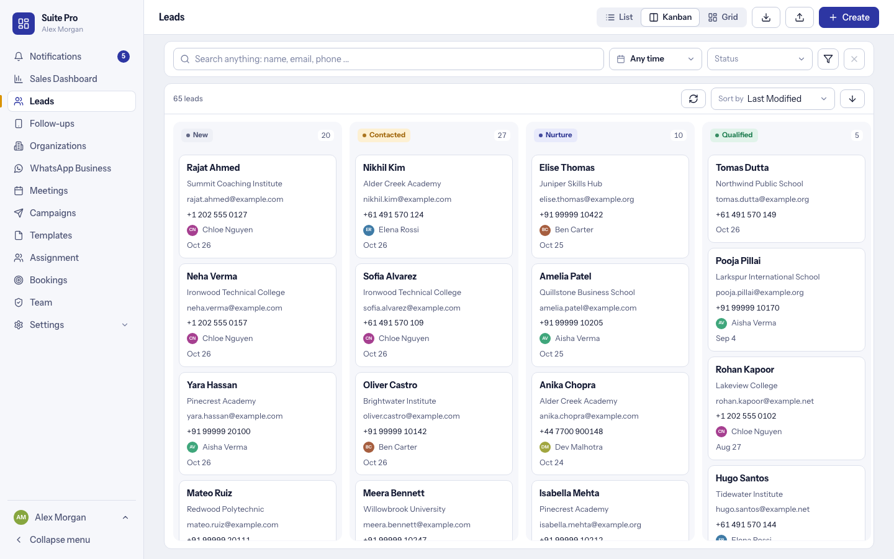
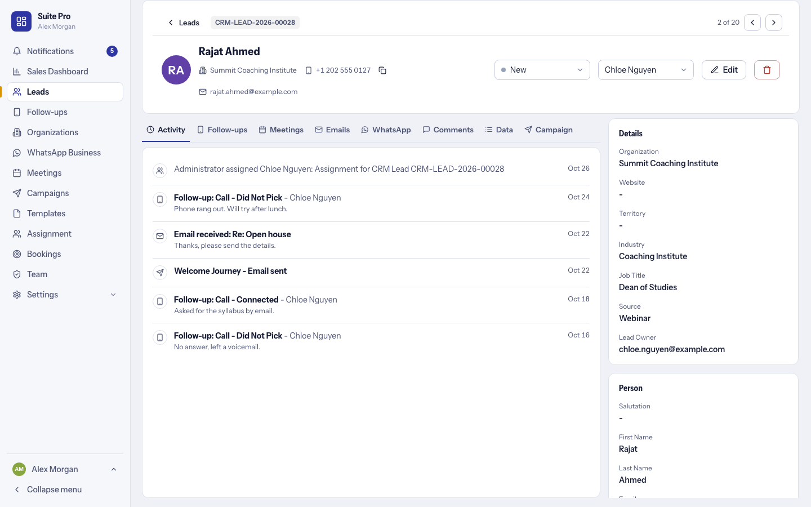

# Leads and the lead page

The Leads and Organizations pages of the [Suite Pro workspace](suite-app.md). They read and write the same CRM Leads as the standard CRM, with the same fields, so the two screens always agree.

## The Leads list

- **Three views:** List, Kanban and Grid. 
- **One search** across every field (name, email, phone, organization and more).
- **Filters:** a date (date added or follow-up due), Status, and the filter button for more. Each filter can *include* or *exclude*, with many values chosen from one dropdown. Saved views keep a set of filters.
- **Columns, sorting and grouping** are yours: choose and reorder columns by dragging, sort in list and Kanban, group by a field. An administrator sets the defaults in **Settings, Leads and sales, Lead page**.
- **Pages:** 20, 50 or 100 per page. Selecting a row (or all rows across every page) shows a bar at the bottom with the bulk actions.

### Bulk actions

Assign, clear the assignment, change the status or owner, edit a field, and **send an email or an approved WhatsApp template** to the selected leads. Templates come only from the library (nothing is typed per send), leads that opted out are skipped, and every send is saved and listed in **Campaigns, Reports, Bulk sends**.

### Import and export

- **Import** from Excel, CSV or a Google Sheet link: match the columns (with examples of each), check the rows, then import with a progress bar. A row that fails never undoes the row before it.
- **Export** opens a dialog to choose and order the columns, as Excel or CSV. A Sales User only exports what they may see.

## The lead page

- **Header:** the ID, back and previous / next arrows (through the list you came from), the status and the owner (change them in place), Edit, and Delete for the main administrator.
- **Tabs:** Activity, Follow-ups, Meetings, Emails, WhatsApp, Comments, Data and Campaign.
  - *Follow-ups* and *Meetings* use the same forms as everywhere else in Suite Pro.
  - *Emails* has a composer with templates, CC and BCC and attachments.
  - *WhatsApp* is the chat of the lead (see [WhatsApp Business](whatsapp-business.md)); a template opens a preview filled in for the lead.
  - *Data* shows the details as cards (organization, person, and more), following the CRM's own field layout.
- **Meta lead ad card:** a lead that came from a Meta lead ad shows the platform, campaign, ad set, ad and form.

## Organizations

A list with your own columns (the default set is in Settings), filters, add, edit and delete, and a page per organization with its leads and deals.

## What an administrator can change

In **Settings** (System Managers): the default view, the top row of filters, the default filters, the columns and the sorting of the Leads screen; and which fields the **Add lead**, **Add organization** and **Add person** forms show, in which order, with which labels, which are required and which dropdown values are hidden. Forms and settings only pick fields and values the CRM already has, so nothing can disagree with the CRM.
