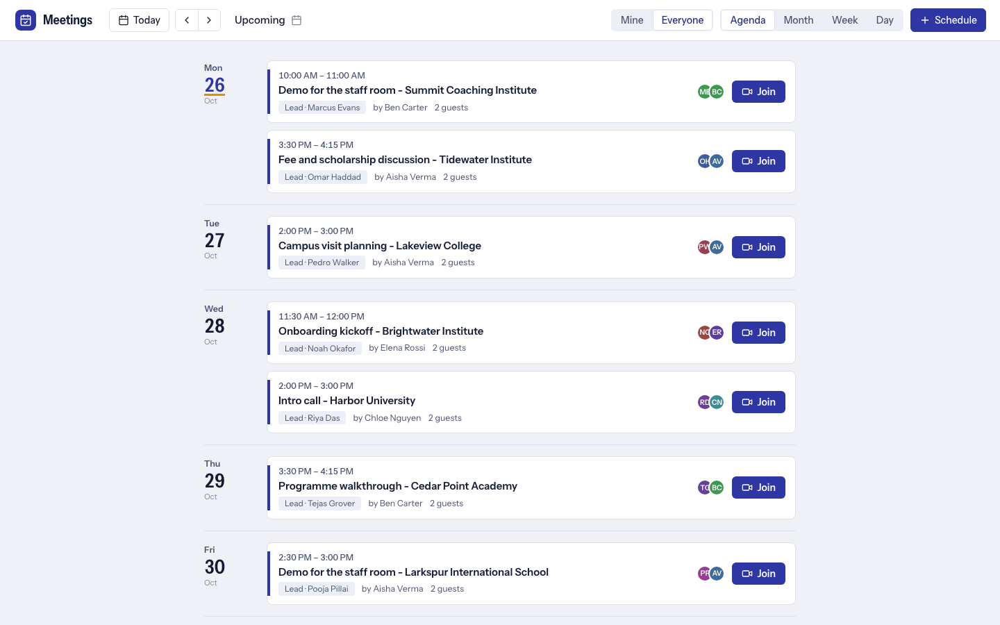
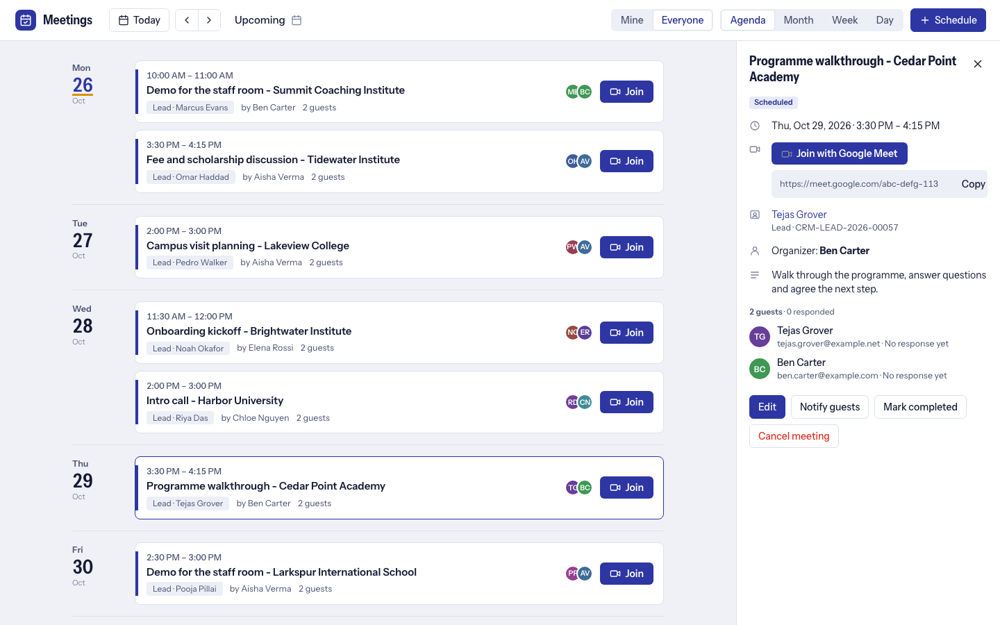

# Meetings and Google Meet

Schedule a meeting from a lead, get a Google Meet link and a Google invitation for the guests, and record how the meeting went. Sales users never sign in to Google: an admin connects **one company Google account** once and meetings are created on its calendar. For the Google Cloud details and error messages see [ADMIN_GUIDE.md](ADMIN_GUIDE.md).

## Schedule a meeting

- Open a Lead and click **Schedule Meeting** (or **New Meeting** on its **Meetings** tab), or open **Meetings** from the left menu for a calendar with Agenda, Month, Week and Day views.
- Pick a time, duration (default 30 minutes), provider (Google Meet, or Manual Link for any Zoom, Teams or other URL) and guests: CRM team members, contacts or any email address. The lead's contact, you and the lead owner are pre-selected.
- Decide whether guests are told: send invitations or not when you schedule, change or cancel. A **Notify guests** button sends a note (email and/or CRM notification) at any time. Google cannot notify only new guests, so a change notifies everyone or nobody.
- **Reminders** go out as CRM notifications and email shortly before (30 minutes by default; an optional early reminder, for example 1440 for a day before). External guests only get reminders if you switch that on.
- **Outcomes:** record Held, No Show or Rescheduled, with notes and an optional next follow-up.
- Every meeting, reschedule and cancellation is posted on the lead's timeline. **Cancel meeting** removes the Google event and tells the guests.

## Connect Google (admin, once, about ten minutes)

1. **Google Cloud Console:** create or pick a project and enable the **Google Calendar API**.
2. **OAuth consent screen (Google Auth Platform):** External (or Internal for a Workspace domain). In *Testing* mode add the company account under Test users, and know that Google expires the login after **7 days**; publish the app (or use Internal) for a permanent setup. The scope used is `https://www.googleapis.com/auth/calendar`.
3. **Create an OAuth client** of type Web application. The **Authorized redirect URI** is shown on the setup page and in CRM Addons Settings; it has the form `https://your-site.com?cmd=frappe.integrations.doctype.google_calendar.google_calendar.google_callback` (no trailing slash).
4. **Frappe > Google Settings:** tick Enable, paste the Client ID and secret.
5. **Frappe > Google Calendar > New:** User = the authorizing admin, a Calendar Name (for example `CRM Pro Pack`), tick **Enable** and **Push to Google Calendar**, leave *Pull from Google Calendar* off (otherwise the whole personal calendar is imported). Save, press **Authorize Google Calendar Access** and sign in with the company account.
6. **CRM Addons Settings** (or the setup page): choose that record as **Company Google Calendar** (done for you if it is the only connected one) and press **Test Google connection**.

Optionally switch on *Use each user's own Google Calendar*: a person who connected their own calendar then organizes their own meetings.

If setup is unfinished a meeting is still saved, without a link, and an admin sees an *Open setup* link in the editor. Times use the site's time zone.

## Not using Google

Choose the **Manual Link** provider and paste any URL; guests get an email with a calendar file. Zoom and Teams meetings created automatically are planned, not available; another app can add a provider through a hook: see [ADDING_A_PROVIDER.md](ADDING_A_PROVIDER.md).
