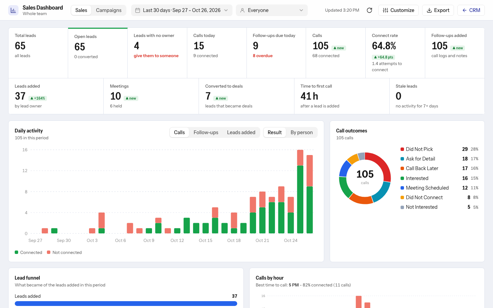
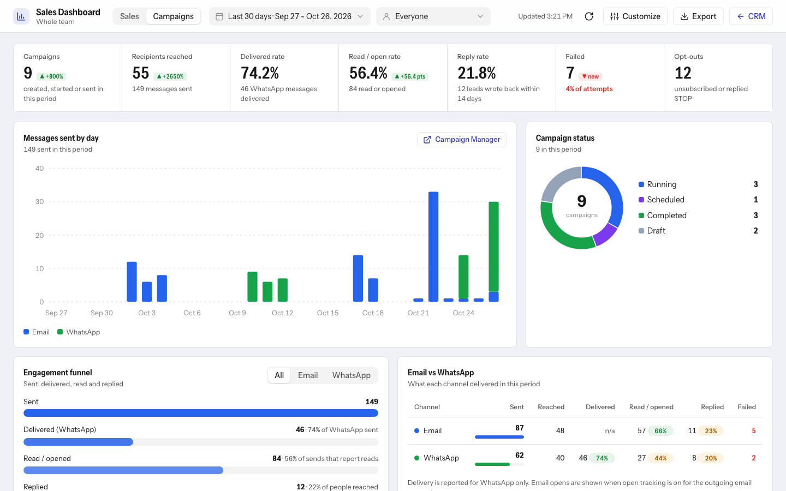

# Sales Dashboard

Open **Sales Dashboard** in CRM's left menu (or the buttons on the Leads list, Kanban view or CRM's Dashboard page). It is a page of the CRM at `/crm/pro-pack-sales-dashboard`, so Back, reload and shared links work; **Open in a new tab** gives the full-screen version at `/sales-dashboard`. Under 900 px wide it opens as a pop-up instead. It follows CRM's light or dark theme.

**Who sees what:** Sales Users see only their own numbers. Sales Managers, System Managers and Administrator see the whole team and can pick one person. The server enforces it, so changing the address shows nothing extra.

## Sales tab

- **Date range picker**, the same one as on the Follow-ups page: presets (today, yesterday, last 7 and 30 days, this and last week, this and last month, this quarter, this year) or a calendar for a custom range, with keyboard support. A range is whole days, first and last included; the cards, charts, exports and the "previous period" comparison (the same number of days right before) all use it. The last range is remembered per page.
- **KPI cards:** calls today, follow-ups due today and overdue, calls, connect rate, follow-ups added, leads added, meetings held, leads converted to deals (hidden when *Hide Deals* is on), average time to first call, stale leads.
- **Charts:** daily activity (calls, follow-ups or leads added, by result or by person), call outcomes, lead funnel (added, contacted, reached on a call, meeting booked, converted), calls by hour with the best time to call, attempts to connect, pipeline by status with average age, leads by source, lead temperature, meetings by outcome.
- **Tables:** team performance and call outcomes by person (managers), the follow-up queue, recent calls and upcoming meetings, each opening the lead.
- **Lead counts:** total, open and unassigned leads, leads counted by any field you choose, your own named counts (such as "Schools") and a **Leads assigned by person** table. Set them on the setup page under *Sales Dashboard counts*.

## Campaigns tab

Shown when the Campaign Manager is on (`/sales-dashboard#nurturing` opens it directly). For the selected date range: campaigns, recipients reached, delivered, read or open and reply rates, failed, opt-outs, messages by day and channel, an engagement funnel, Email vs WhatsApp, campaigns by status, top campaigns (each opens in the Campaign Manager) and how many open leads were nurtured. These campaign results are company-wide numbers for everyone. Email opens only appear when open tracking exists; the cards say so instead of guessing.

## Customize and export

- **Customize** (Sales Managers and System Managers only): show or hide each number and chart, reorder them (grip, arrows or drag) and set each chart's width. The layout is saved per user with *Reset to default*.
- **Export:** an Excel workbook with a sheet per section plus the full call log, or the call log as CSV. The Campaigns tab has its own Excel and CSV export. Sales Users can only export their own numbers.
- The page refreshes itself every two minutes while open.

## CRM's own Dashboard

Pro Pack also registers charts for CRM's Dashboard page: meetings today, meetings in the next 7 days, meetings, follow-ups due today, overdue follow-ups, call connect rate, attempts to connect, meetings by day, follow-ups by day, activity by salesperson, meetings by status, follow-ups by outcome, calls by result, leads by score and meetings by outcome. Add them from CRM's dashboard editor.
