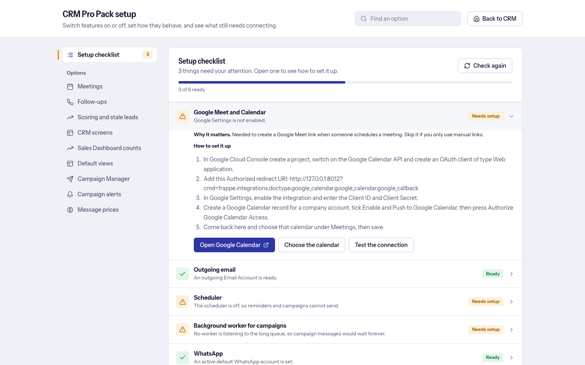

# Settings reference

All settings live in one record, **CRM Addons Settings**. Edit them on the setup page (`/pro-pack-setup`, System Managers), which groups them, explains each with an (i) button, validates numbers and locks options whose parent switch is off; the classic form at `/app/crm-addons-settings` still works and writes the same record. The defaults below are the ones in the doctype definition (`crm_addons_settings.json`); installing never overwrites a value an admin changed.

## Meetings (provider, Google, reminders)

| Setting (field name) | Default | What it does |
|---|---|---|
| Default Provider (`default_provider`) | `Google Meet` | Meeting provider preselected for new meetings: Google Meet or Manual Link (paste any URL). Zoom and Teams are not available yet; other apps can add providers through a hook. |
| Default Duration (minutes) (`default_duration`) | `30` | Length of a new meeting, in minutes. |
| Add a video meeting by default (`default_add_video_meeting`) | On | Pre-ticks "add a video meeting" in the meeting form. |
| Company Google Calendar (`google_calendar`) | empty | The Google Calendar record every meeting is created on, so sales users never log in to Google. Selected automatically when exactly one calendar is connected. |
| Use each user's own Google Calendar when they have one (`use_personal_calendars`) | Off | Off: all meetings go on the company calendar. On: a user with their own connected Google Calendar organizes their own meetings there. |
| Send in-app CRM notifications when a meeting is scheduled, changed or cancelled (`notify_on_schedule`) | On | In-app CRM notification to the team when a meeting is scheduled, changed or cancelled. |
| Send reminders before a meeting starts (`reminders_enabled`) | On | Send reminders before a meeting starts (a job runs every 5 minutes). |
| Reminder (minutes before) (`reminder_minutes_before`) | `30` | Minutes before the start for the reminder. Needs reminders on. |
| Early reminder (minutes before, 0 = off) (`early_reminder_minutes`) | `0` | A second, earlier reminder, for example 1440 for one day before. 0 turns it off. |
| Email reminders to CRM team members (`email_reminders`) | On | Also email the reminder to CRM team members (not only a notification). |
| Also email reminders to external guests (`remind_guests`) | Off | Also email reminders to external guests (off because Google already reminds them). |

## Follow-ups

| Setting (field name) | Default | What it does |
|---|---|---|
| Enable follow-ups (call attempts and outcomes) (`enable_follow_ups`) | On | Master switch for follow-ups (call attempts and outcomes). |
| Remind the follow-up owner when a follow-up is due (`follow_up_reminders`) | On | Notify (and email, if email reminders are on) the follow-up owner when a follow-up becomes due. |
| Escalate after this many calls in a row that were not picked or connected (0 = off) (`escalate_after_attempts`) | `3` | After this many calls in a row that did not reach the lead, add a timeline note and notify the lead owner and all Sales Managers. 0 = off. |
| Lead status to set when escalated (`unreachable_lead_status`) | empty | Optional Lead Status to move the lead to when escalated (for example Unreachable). Empty only notifies. |

## Scoring and stale leads

| Setting (field name) | Default | What it does |
|---|---|---|
| Score Leads from their activity (`lead_scoring_enabled`) | On | Compute the 0-100 Lead Score (Hot / Warm / Cold) from activity. |
| Alert the owner after this many days without activity (0 = off) (`stale_lead_days`) | `7` | Notify the owner of an open lead with no comment, email, call, task, note, follow-up or meeting for this many days, once per quiet spell. 0 = off. |
| Default WhatsApp message after a missed call (`missed_call_whatsapp_text`) | a friendly text | Message offered in the follow-up form after a Did Not Pick / Did Not Connect call, when WhatsApp is set up in CRM. |

## CRM interface

| Setting (field name) | Default | What it does |
|---|---|---|
| Show a "Schedule Meeting" button on Lead pages (`show_record_buttons`) | On | "Schedule Meeting" button on the Lead page. Turn off if your CRM already has a Meetings tab. |
| Show "Meetings" and "Follow-ups" buttons on the Leads list pages (`show_list_button`) | On | "Meetings" and "Follow-ups" buttons on the Leads list pages. |
| Show an "Add Follow Up" button at the top of the Lead page (next to Schedule Meeting) (`show_follow_up_button`) | On | "Add Follow Up" button at the top of the Lead page. Needs follow-ups on. |
| Show floating Meetings / Follow-ups buttons on the Kanban view of Leads (`show_floating_buttons`) | On | Floating Meetings / Follow-ups / Sales Dashboard buttons on the Leads Kanban view. |
| Show links in the side menu (`show_sidebar_links`) | On | Sales Dashboard, Follow-ups, Meetings and Campaigns rows in CRM's left menu and a button group in the Dashboard header (Assignment for System Managers). |
| Add Meetings and Follow-ups tabs to Lead pages (`show_record_tabs`) | On | Meetings and Follow-ups tabs on Lead pages. |
| Hide "Deals" from the CRM side menu (`hide_deals_menu`) | Off | Hide Deals from the left menu, and "Converted to deals" from the dashboard, funnel and exports. Screen only: the Deals pages stay reachable by address. |
| Hide "Notes" from the CRM side menu (`hide_notes_menu`) | Off | Hide Notes from the left menu (screen only). |
| Hide "Tasks" from the CRM side menu (`hide_tasks_menu`) | Off | Hide Tasks from the left menu (screen only). |
| Hide "Call Logs" from the CRM side menu (`hide_call_logs_menu`) | Off | Hide Call Logs from the left menu (screen only). |
| Hide the "Convert to Deal" button on the Lead page (`hide_convert_button`) | Off | Hide the "Convert to Deal" button (found by its label, so check after a CRM update). |
| Hide the "Calls" tab on Lead pages (`hide_lead_calls_tab`) | Off | Hide the Calls tab on Lead pages (nothing is deleted or blocked). |
| Hide the "Tasks" tab on Lead pages (`hide_lead_tasks_tab`) | Off | Hide the Tasks tab on Lead pages. |
| Hide the "Notes" tab on Lead pages (`hide_lead_notes_tab`) | Off | Hide the Notes tab on Lead pages. |

## Campaign Manager

| Setting (field name) | Default | What it does |
|---|---|---|
| Enable Campaign Manager (`campaigns_enabled`) | On | Master switch for the Campaign Manager (buttons, menu rows, Campaigns tab, jobs' UI). |
| Roles that see the Campaigns shortcuts (`campaign_shortcut_roles`) | empty | Comma-separated roles that see the Campaigns button and menu link. Empty: everyone sees them. Set on the setup page as role ticks. |
| Messages per batch (`campaign_batch_size`) | `100` | Messages one dispatcher tick hands to the workers, per campaign. |
| Maximum messages per minute (per campaign) (`campaign_rate_per_minute`) | `300` | Ceiling of messages per minute, per campaign. Keep it under your Meta throughput and mail provider limits. |
| Automatic retries (`campaign_max_retries`) | `2` | Automatic retries, only for failures that prove the provider did not accept the message (rate limits, connection errors); back-off from 5 minutes. |
| WhatsApp consent (`whatsapp_consent_mode`) | `Require opt-in` | Require opt-in: only leads with the WhatsApp Opt-in box ticked (or consent confirmed on the campaign). Allow unless opted out: every lead with a valid number. The opt-out list wins in both. |
| Default country code (`default_country_code`) | empty | Digits such as 91, added to WhatsApp numbers of up to 10 digits that have no country code. |
| Warn me when a campaign has problems (`campaign_alerts_enabled`) | On | Warn the campaign owner when a campaign has problems (checked every 5 minutes). |
| Failure rate that triggers a warning (`campaign_alert_failure_percent`) | `30` | Failure rate over the last hour that triggers the warning. |
| Only after this many messages in the last hour (`campaign_alert_min_messages`) | `20` | Do not warn until at least this many messages went out in the last hour. |
| Price per email (`campaign_cost_email`) | empty | Price per email, in your company currency. Empty: no cost shown. |
| Price per WhatsApp marketing message (`campaign_cost_whatsapp_marketing`) | empty | Price per WhatsApp marketing message (cost and ROI). |
| Price per WhatsApp utility message (`campaign_cost_whatsapp_utility`) | empty | Price per WhatsApp utility message. |
| Price per WhatsApp authentication message (`campaign_cost_whatsapp_authentication`) | empty | Price per WhatsApp authentication message. |

## Hidden settings written by the setup page

`sidebar_layout` (left menu order and visibility), `view_defaults` (default list / Kanban views), `dashboard_breakdowns` and `dashboard_counters` (Sales Dashboard counts). They hold JSON and are meant to be edited on the setup page only.

## Other

- `campaign_max_attachment_mb`: the attachment limit per email is read from this name on CRM Addons Settings. The form has no field for it, so the default of **30 MB** applies (never above Frappe's *Max File Size* in System Settings) unless you add a Custom Field of that name to CRM Addons Settings.
- **CRM Follow Up Template** (Desk) holds the quick-fill follow-up templates.
- Roles: see [Roles and permissions](roles-and-permissions.md).
