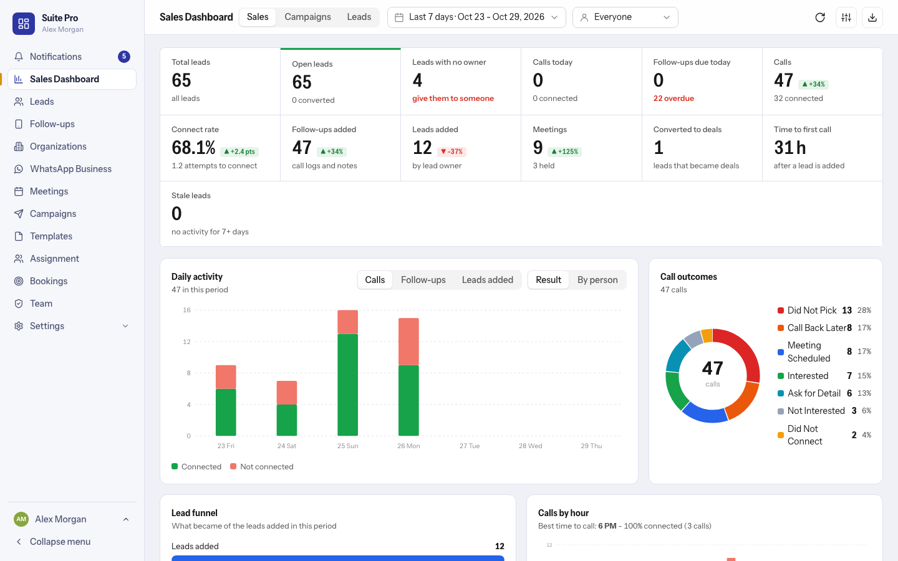
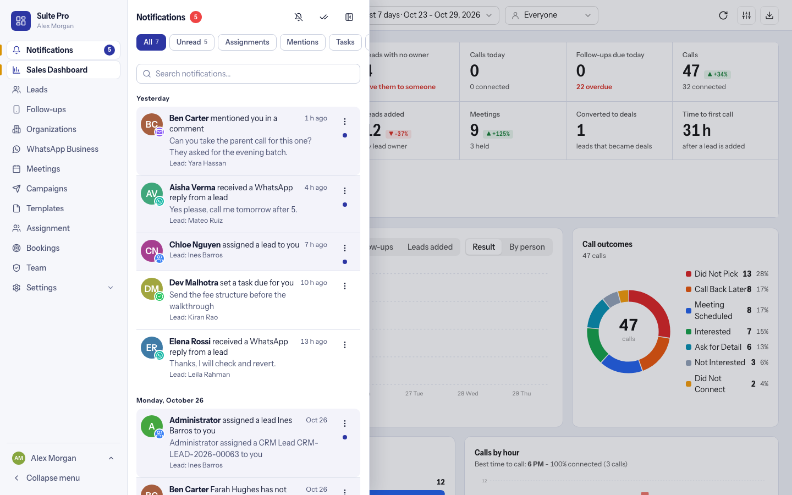

# The Suite Pro workspace

Release 2.0.0 adds a full workspace at **`/suite`**: one app with its own left menu, for people who want to work in Suite Pro rather than inside the standard CRM screens. It sits beside the CRM, it does not replace it.

## Opening it

| Way in | What happens |
|---|---|
| `https://your-site/suite` | The workspace opens on the Sales Dashboard (or the first page the person may use). |
| The app screen (`/apps`) | Suite Pro has its own tile, next to CRM, for everyone who works in the CRM. |
| `https://your-site/crm-pro` | The first name of the workspace. It redirects to `/suite`, so old links still work. |
| The standard CRM at `/crm` | Unchanged. Everything from the earlier releases (tabs on the lead page, Meetings and Follow-ups buttons, menu shortcuts) is still there. |

Nobody has to use the workspace. Leaving it alone changes nothing for people who stay in the CRM.

## Make it the default app (administrators)

By default a site opens the standard CRM after sign-in. A System Manager can make Suite Pro the page everyone lands on:

- **The offer.** The first time an administrator opens the CRM after the upgrade, a small window asks *Open Suite Pro first?* Choose **Make Suite Pro the default**, **Take a look first** (opens `/suite`) or **Keep the CRM**. It is asked once per administrator.
- **Later, by hand.** Open **System Settings**, set **Default App** to *Frappe CRM Suite Pro* (or back to *CRM*) and save. A person can choose their own default app in their user settings; that choice wins.
- The CRM stays available at `/crm` whichever you choose.

Only a person who holds a CRM role (System Manager, Sales Manager or Sales User) sees the Suite Pro tile and is sent to it.

## The menu

| Menu | What it is | Who sees it |
|---|---|---|
| Notifications | A panel beside the menu, see below | Everyone |
| Sales Dashboard | [Sales Dashboard](sales-dashboard.md) | By permission |
| Leads | [Leads and the lead page](leads.md) | By permission |
| Follow-ups | [Follow-ups](follow-ups.md) | By permission |
| Organizations | List, filters, add and edit, with each organization's leads | By permission |
| WhatsApp Business | [WhatsApp Business inbox](whatsapp-business.md) | By permission, and only when `frappe_whatsapp` is installed |
| Meetings | [Meetings](meetings-google.md) | By permission |
| Campaigns, Templates | [Campaigns](campaigns.md) | Campaign Managers; Sales Users can look |
| Assignment | [Lead assignment](lead-assignment.md) | People who may assign |
| Bookings | Website bookings, widgets, [lead forms](lead-forms.md) and their reports and logs | By permission |
| Team | People, Hierarchy and Presets, see [Roles and permissions](roles-and-permissions.md) | System Managers, or a person given the Team page |
| Settings | Setup checklist, branding, leads screen, integrations, campaign options | System Managers |

A page a person has no access to is hidden from their menu, and the server refuses it if they type the address.

## Notifications

Click **Notifications** in the menu: a panel slides out from the menu's edge. Click anywhere outside it, or the hide button, to close it.

- Chips: **All**, **Unread**, **Assignments**, **Mentions**, **Tasks** and **WhatsApp**, each with the right count. Scroll or drag the chips sideways when the panel is narrow.
- Search by text or lead; notifications are grouped as Today, Yesterday and by date.
- A blue dot marks an unread row. The three-dot menu marks it read or unread, or opens the lead in the CRM. The double-tick button marks everything read.
- The **bell** button turns on sound and desktop alerts. While Suite Pro is open in a browser tab, a short sound and a desktop notification tell you when something new arrives (the page checks every 30 seconds). The browser asks for permission the first time; the choice is remembered per browser.

## Look and behaviour

- One font, one set of controls and the same calendar, time and dropdown pickers on every page.
- Every table and card grid is paged; every log has a date range in its header.
- It works on a phone: the menu becomes a strip across the top.
- The workspace uses the same data and the same server-side permission checks as the CRM pages, so what a person can see does not depend on which screen they use.
