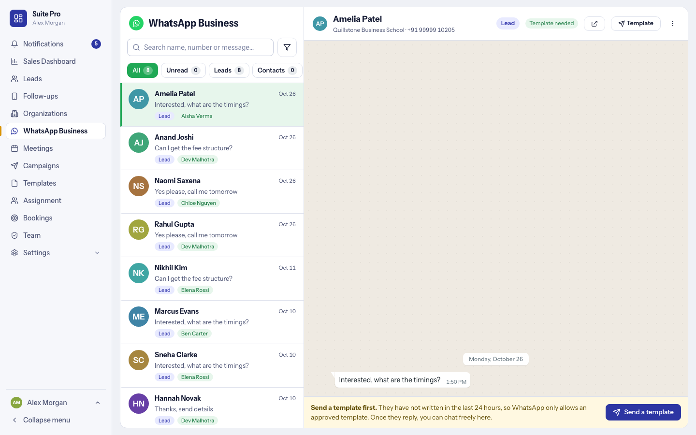

# WhatsApp Business inbox

A shared inbox for the WhatsApp number connected through [`frappe_whatsapp`](https://github.com/shridarpatil/frappe_whatsapp). It needs that app, an active WhatsApp account and (to start a chat) a template approved by Meta.

## The chat list

- **Every chat in one place**, including numbers that are not leads yet.
- **Filters with counts:** All, Unread, Leads, Contacts and more; one scrolling row. Search by name, number or message.
- Each chat shows the last message, the time and a tag: *Lead* with the owner's name, or the state of a new number.
- The same last ten digits under a different country code is treated as a separate chat, so two people are never merged.

## A chat

- **Header:** the name (click to open the lead), the company, the Lead tag, how long the 24-hour window stays open, open in a new tab, **Template**, and a three-dot menu with the details.
- **24-hour rule.** WhatsApp only allows free-form messages for 24 hours after the person last wrote. Until then the box asks you to **send a template** (it shows only approved WhatsApp templates, filled in for the lead). Once they reply you chat freely.
- **Writing:** emoji with groups, an attach menu for **image, video or document**, **saved replies** (type `/`), replies to a message and reactions. Messages run oldest to newest, with dates in the middle and real sent, delivered and read ticks.
- **Saved replies** are managed in **Templates, WhatsApp saved replies**: cards with a preview, variables filled in for the lead, and an optional file sent along.
- A chat opened in a new tab shows only that chat.
- On a lead page the same chat is the **WhatsApp** tab.

## Numbers that are not leads

A message from a number the CRM does not know appears in the list. From there you can **create a lead** from it, **link it to an existing lead**, or mark it **not a lead**.

## Who sees what

Set per person (or preset) in **Team, Presets**, the permission *WhatsApp inbox*:

| Level | The person sees |
|---|---|
| No access | The menu entry is hidden. |
| Own | The chats of leads they own, and the new numbers assigned to them. |
| Everyone | All chats and the new numbers nobody has picked up, and can assign them. |

Each person has their own unread number.

## Setup and health

Connect or switch the number in **Settings, Integrations, WhatsApp**. The setup checklist and the integration page show whether the WhatsApp app, the account and the webhook are healthy, and say what to fix.
